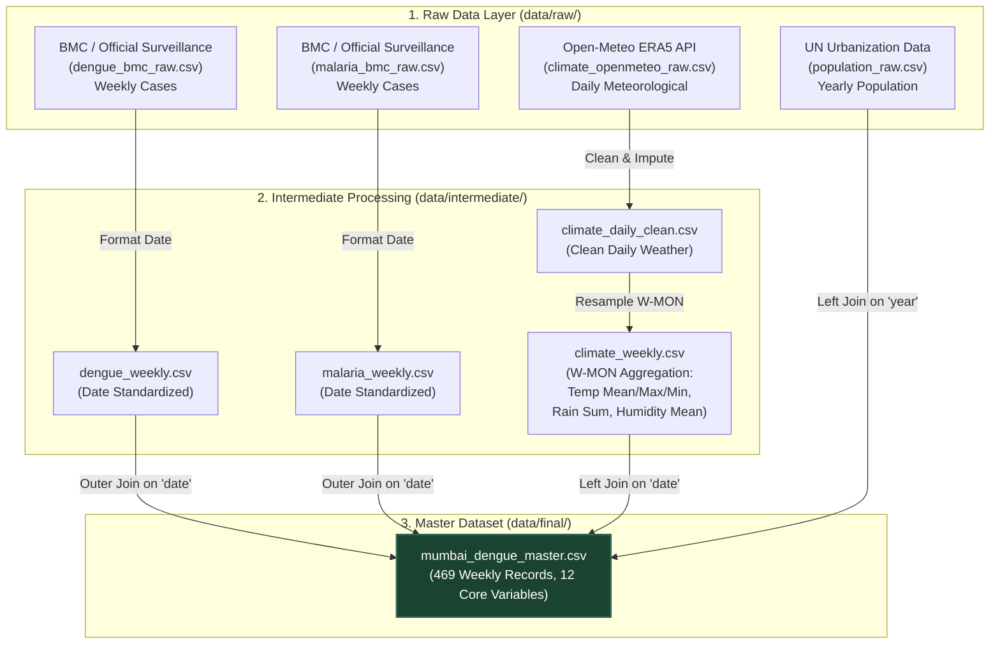

# Data Architecture, Pipeline Lineage, and Feature Connections

This document details the **end-to-end data pipeline architecture**, explaining how raw multi-modal datasets are collected, transformed, temporally aligned, and connected to build the final model-ready dataset.

---

## 1. End-to-End Pipeline Data Flow

The data engineering pipeline consists of three distinct stages: **Raw Ingestion**, **Intermediate Cleaning & Aggregation**, and **Master Temporal Fusion**.



---

## 2. How the Datasets are Connected

### A. Temporal Synchronization (The "Join Key")
* **Mismatch Problem**: Climate data is recorded **daily**, population data is recorded **yearly**, and disease surveillance data is recorded **weekly**.
* **Solution**: We establish a unified temporal index based on **ISO Standard Weeks starting on Monday (`W-MON`)**.
  * **Daily Weather $\rightarrow$ Weekly Aggregation**: Daily climate observations are grouped into 7-day windows ending on Monday. 
    * Temperature variables (`Temp_Mean_C`, `Temp_Max_C`, `Temp_Min_C`) and `Relative_Humidity_Pct` are averaged over the 7 days.
    * Rainfall (`Rainfall_Cumulative_mm`) is summed over the 7 days.
  * **Yearly Population $\rightarrow$ Weekly Alignment**: The annual population estimate is broadcasted across all weeks belonging to that calendar year.

### B. Mathematical Normalization (Incidence Rates)
To prevent model distortion due to population growth (from 19.39M to 21.67M over the study period), case counts are connected with population using the formula:
$$\text{Dengue Incidence Rate}_{t} = \left( \frac{\text{dengue\_cases}_{t}}{\text{population}_{\text{year}(t)}} \right) \times 100,000$$

---

## 3. Biological and Ecological Interconnections

The features in the master dataset are not just statistically correlated—they are connected by **strict biological and ecological mechanisms**:

```
                       ┌─────────────────────────┐
                       │   RAIN & PRECIPITATION  │
                       └────────────┬────────────┘
                                    │
                                    │ Creates stagnant water pools
                                    ▼
┌───────────────────────┐  Breeding Grounds   ┌─────────────────────────┐
│   TEMPERATURE & RH    ├────────────────────►│ AEDES AEGYPTI MOSQUITO  │
│ (Mean/Max/Min Temp,   │  Accelerates Larvae │     POPULATION GROWTH   │
│  Relative Humidity)   │  & Viral Replication└────────────┬────────────┘
└───────────────────────┘                                   │
                                                            │ Mosquito Bites Host
                                                            ▼
                                              ┌─────────────────────────┐
                                              │   HUMAN DENGUE OUTBREAK │
                                              │   (Lagged by 2-8 Weeks) │
                                              └─────────────────────────┘
```

1. **Precipitation $\rightarrow$ Mosquito Breeding**: Rain creates stagnant water pools necessary for female *Aedes aegypti* mosquitoes to lay eggs.
2. **Temperature $\rightarrow$ Extrinsic Incubation Period (EIP)**: Higher temperatures shorten the EIP (the time it takes for the dengue virus to replicate inside the mosquito before it becomes infectious).
3. **Relative Humidity $\rightarrow$ Mosquito Lifespan**: Relative humidity above 60% drastically increases mosquito survival rates, giving them more opportunities to transmit the virus.
4. **Malaria $\rightarrow$ Co-Surveillance Indicator**: Malaria serves as an auxiliary indicator of overall vector activity and municipal health surveillance load during the monsoon.

---

## 4. Code Execution Lineage

1. **[`src/data_pipeline.py`](file:///c:/Dengue_DE/dengue_mumbai_project/src/data_pipeline.py)**:
   - Fetches historical climate via Open-Meteo ERA5 API.
   - Loads population and epidemiological raw files.
   - Outputs raw files into `data/raw/`.

2. **[`src/data_processing.py`](file:///c:/Dengue_DE/dengue_mumbai_project/src/data_processing.py)**:
   - Resamples climate from daily to weekly (`W-MON`).
   - Merges all four sources into `mumbai_dengue_master.csv`.
   - Computes incidence rates.
   - Handles missing value imputation.
