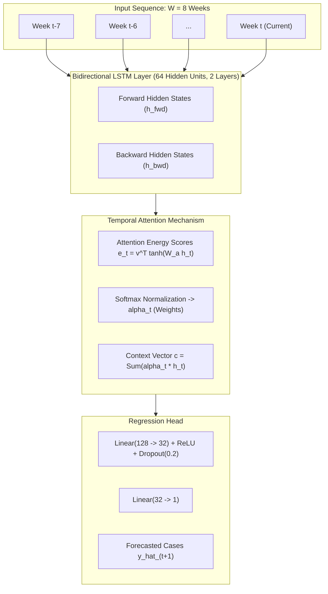

# Deep Learning Model Architecture & Experimental Design

This document details the mathematical formulation, neural network architecture, data splitting methodology, and evaluation protocols for **Phase 3: Climate-Informed Deep Learning Forecasting**.

---

## 1. Problem Formulation

We frame weekly dengue outbreak prediction in Greater Mumbai as a **multivariate temporal sequence-to-point regression task**:

Given a historical lookback window of $W = 8$ weeks containing $D = 72$ meteorological and epidemiological features:
$$\mathbf{X}_{t} = \left[ \mathbf{x}_{t-W+1}, \mathbf{x}_{t-W+2}, \dots, \mathbf{x}_{t} \right] \in \mathbb{R}^{W \times D}$$

The model predicts the dengue outbreak intensity for the subsequent week $t+1$:
$$\hat{y}_{t+1} = f_\theta(\mathbf{X}_{t})$$
where $\theta$ represents the trainable weights of the neural network.

---

## 2. Chronological Train / Validation / Test Splitting

To ensure realistic epidemiological validation and **zero data leakage across temporal boundaries**, we employ a strict chronological partition:

```
[2015 ........................ 2020]  [2021 ......... 2022]  [2023 ...........]
           TRAINING SET                      VALIDATION SET         TEST SET
            (305 Weeks)                        (104 Weeks)          (52 Weeks)
    Pre-monsoon, monsoon, &             Post-COVID Recovery       Surge Outbreak
      baseline epidemics                    Calibration           Evaluation
```

* **Training Set (2015–2020, 305 weeks)**: Used for gradient updates.
* **Validation Set (2021–2022, 104 weeks)**: Used for learning rate scheduling (`ReduceLROnPlateau`) and Early Stopping ($patience = 15$).
* **Out-of-Sample Test Set (2023, 52 weeks)**: Withheld strictly for final evaluation. The year 2023 saw historic record-breaking dengue transmission in Mumbai, providing a stress-test of out-of-sample generalization.

> **Data Leakage Safeguard**: Scalers (`MinMaxScaler`) are fit **strictly on the Training Set** and applied downstream to Validation and Test sets.

---

## 3. Proposed Deep Learning Architecture: BiLSTM with Temporal Attention

Standard unidirectional LSTMs only process temporal features chronologically from left to right. Our architecture implements **Bidirectional LSTM with Bahdanau-style Temporal Attention**:



### Mathematical Mechanism:
1. **Bidirectional Hidden Representation**:
   $$h_t = \left[ \overrightarrow{h}_t \,;\, \overleftarrow{h}_t \right] \in \mathbb{R}^{2d} \quad \text{for } t \in \{1, \dots, W\}$$
2. **Attention Scoring**:
   $$e_t = \mathbf{v}^\top \tanh(\mathbf{W}_a h_t + \mathbf{b}_a)$$
3. **Normalized Temporal Weights**:
   $$\alpha_t = \frac{\exp(e_t)}{\sum_{k=1}^W \exp(e_k)}$$
4. **Context Vector Generation**:
   $$\mathbf{c} = \sum_{t=1}^W \alpha_t h_t$$
5. **Dense Output Projection**:
   $$\hat{y}_{t+1} = \mathbf{W}_2 \, \text{ReLU}(\mathbf{W}_1 \mathbf{c} + \mathbf{b}_1) + b_2$$

---

## 4. Benchmark Models for Comparison

To substantiate publication claims, our evaluation framework compares against classical and tree-based baselines:
1. **Persistence Baseline**: $\hat{y}_{t+1} = y_t$ (null forecast).
2. **Ridge Regression**: $L_2$-regularized linear regression on flattened sliding window features.
3. **Random Forest Regressor**: 100-tree ensemble capturing non-linear interactions without recurrent state.
4. **Standard Unidirectional LSTM**: 2-layer LSTM without attention.
5. **BiLSTM-Attention (Proposed)**: Complete spatiotemporal attention architecture.

---

## 5. Evaluation Metrics

Model performance is evaluated across three complementary metrics:
* **Root Mean Squared Error (RMSE)**: Penalizes severe epidemic underprediction during outbreak peaks.
  $$\text{RMSE} = \sqrt{\frac{1}{N} \sum_{i=1}^N (y_i - \hat{y}_i)^2}$$
* **Mean Absolute Error (MAE)**: Measures average case discrepancy across the entire annual cycle.
  $$\text{MAE} = \frac{1}{N} \sum_{i=1}^N |y_i - \hat{y}_i|$$
* **Coefficient of Determination ($R^2$)**: Quantifies proportion of epidemiological variance explained by the model.
  $$R^2 = 1 - \frac{\sum_{i=1}^N (y_i - \hat{y}_i)^2}{\sum_{i=1}^N (y_i - \bar{y})^2}$$
